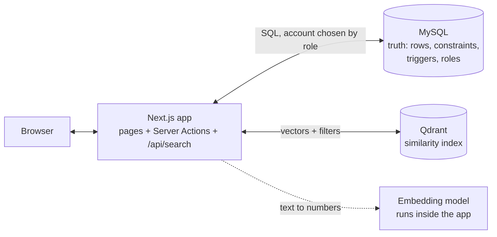
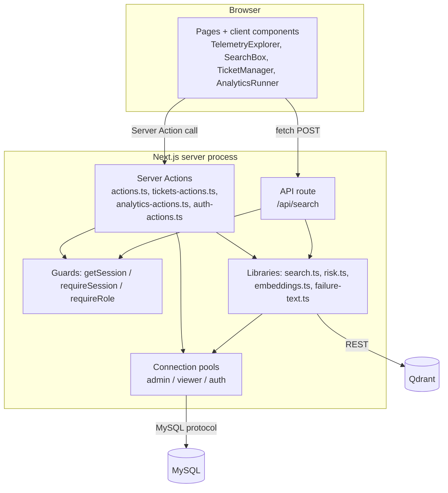
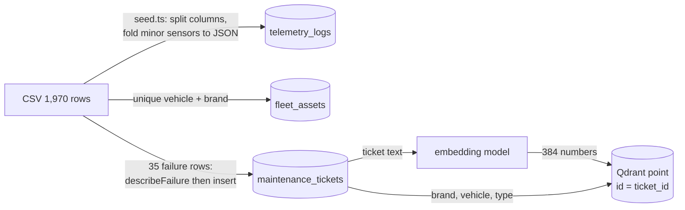
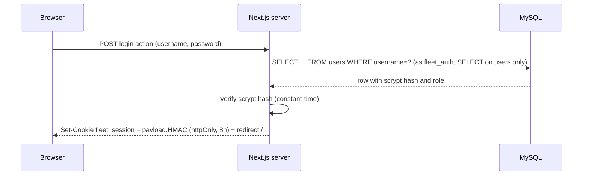
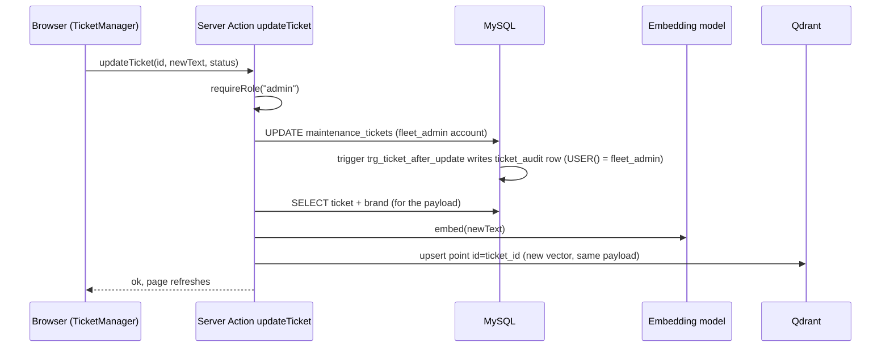
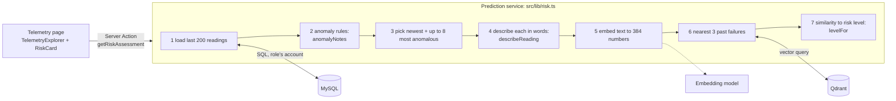

# Deep Dive (detailed reference)

> The short, easy-to-read explanation is in `PROJECT_EXPLAINER.md`. This file is the detailed reference: storage internals, request sequence diagrams, the prediction service, and (section 12) step-by-step recipes for changing the databases.

A ground-up walkthrough: what the project is, what each database stores and how, how a request travels through
the system, and why each decision was made. Read sections 1 to 8 once for the big picture; use the rest as a
reference and a viva cheat-sheet.

| # | Section | Answers |
|---|---|---|
| 0 | [The whole project in one page](#0-the-whole-project-in-one-page) | What is this, in 60 seconds? |
| 1 | [The problem and the goal](#1-the-problem-and-the-goal) | Why does it exist? |
| 2 | [Core concepts](#2-core-concepts) | The vocabulary you need, including what Node.js is and why it is used |
| 3 | [The dataset](#3-the-dataset) | What data goes in? |
| 4 | [Architecture](#4-architecture) | What are the parts and who talks to whom? |
| 5 | [What is stored where, and how](#5-what-is-stored-where-and-how) | What does MySQL store? What does Qdrant store? How, physically? |
| 6 | [How a request flows through the system](#6-how-a-request-flows-through-the-system) | What happens from click to result? |
| 7 | [How semantic search works](#7-how-semantic-search-works) | Text to vector to result |
| 8 | [The prediction service](#8-the-prediction-service-failure-risk-scoring) | Where "prediction" happens, step by step, and how reliable it is |
| 9 | [Login and role-based access](#9-login-and-role-based-access) | Who may do what, and who enforces it |
| 10 | [MySQL features in detail](#10-mysql-features-in-detail) | Partitions, triggers, procedures, analytics |
| 11 | [Startup and seeding](#11-startup-and-seeding) | How the system gets its data |
| 12 | [Where the code lives and how to change it](#12-where-the-code-lives-and-how-to-change-it) | Which file/line holds each slide topic; how to open the databases and make changes |
| 13 | [Folder map and file reference](#13-folder-map-and-file-reference) | Where is each thing? |
| 14 | [Design decisions](#14-design-decisions) | Why this way? |
| 15 | [Limitations](#15-limitations) | What it does not do |
| 16 | [Viva questions](#16-viva-questions) | Likely questions with answers |

---

## 0. The whole project in one page

**What it is.** A web app for a vehicle fleet. It stores IoT sensor readings and maintenance tickets, shows
dashboards, lets staff search past failures *by meaning*, and flags readings that resemble past failures.

**Two databases, one app.**

| | MySQL 8.4 | Qdrant |
|---|---|---|
| Kind | Relational (SQL) | Vector database |
| Holds | Vehicles, 1,970 readings, 35 tickets, users, audit log | 35 vectors (one per ticket) + a little metadata each |
| Answers | "Show vehicle X's readings", "who edited ticket 7?" | "Which past failures are most like this sentence?" |
| Role | **Source of truth** | **Derived search index** (can be rebuilt from MySQL) |

**One web app in front.** Next.js (running on Node.js) serves the pages and runs the server-side code, including a small prediction service that flags readings resembling past failures. The browser never talks to a
database. Logged-in users get one of two roles, and MySQL itself enforces what each role may do.

**The glue.** A ticket exists in both databases under the same number: `ticket_id` in MySQL equals the point id in
Qdrant. A search finds ids in Qdrant, then fetches the full tickets from MySQL.



---

## 1. The problem and the goal

A logistics company runs a fleet. Each vehicle's sensors report engine temperature, RPM, speed, GPS, battery,
brakes and more every few minutes, which makes a large, time-ordered stream. Staff need two kinds of answers:

1. **Precise, structured questions**: "this vehicle's last 200 readings", "average temperature per brand per day".
   A **relational database** is built for this: exact rows, joins, constraints.
2. **Fuzzy, meaning-based questions**: "has anything like *overheating engines in BMWs* happened before?".
   Past failures are described in words that never match exactly, so keyword search fails. A **vector
   database** finds texts that *mean* something similar.

Hence the design: each database does what it is best at, and the app combines them.

---

## 2. Core concepts

### 2.1 Relational database essentials
- **Table / row / column**: data as a grid. **Primary key**: uniquely identifies a row. **Foreign key**: a column
  pointing at another table's key. **Constraints** (`NOT NULL`, `UNIQUE`, `CHECK`, foreign keys) make the database
  refuse bad data itself, regardless of which program is writing.
- **SQL**: `SELECT` (read), `INSERT/UPDATE/DELETE` (**DML**, change data), `CREATE TABLE` (**DDL**, define structure).
- **Join**: combine rows from two tables on matching columns.
- **Index**: a side structure that finds rows without reading the whole table (like a book's index).
- **Transaction**: a group of changes that succeed or fail together.

### 2.2 MySQL features used here
- **Partitioning**: one logical table split into physical pieces by a rule (here: by month of `timestamp`).
  A query for one day reads only that month's piece (**partition pruning**).
- **JSON column**: a column holding a JSON document; used for the ~27 minor sensors.
- **View**: a saved query that looks like a table (`daily_fleet_stats`).
- **Function / stored procedure**: code stored in the database, returning a value / run with `CALL`.
- **Trigger**: code the database runs *automatically* on insert/update/delete.
- **CTE / recursive CTE**: named temporary results; a recursive one refers to itself (we use it to generate time
  buckets). **Subquery**: a query inside a query; **correlated** if it uses the current outer row.
  **Window function**: ranks/aggregates across related rows without collapsing them.
- **Roles and `GRANT`**: named privilege sets attached to database accounts.

### 2.3 Vector database essentials
- **Embedding**: a model turns a text into a fixed-length list of numbers (a **vector**). Texts with similar
  meaning get vectors pointing in similar directions. Ours: 384 numbers per text.
- **Cosine similarity**: compares two vectors by the angle between them. 1 = same direction (very similar),
  around 0 = unrelated. Qdrant ranks by this.
- **Point**: Qdrant's unit of storage: *id + vector + payload*.
- **Payload**: JSON metadata stored beside the vector. **Payload filtering** restricts a search to points whose
  payload matches (e.g. `brand = BMW`).
- **Collection**: Qdrant's equivalent of a table: a set of points with the same vector size and distance metric.
- **Nearest-neighbour search**: find the stored vectors closest to a query vector. Exact (compare to all) or
  approximate (**HNSW** graph index, used once collections are large).

### 2.4 The two ideas that hold the architecture together
- **Source of truth vs derived index.** MySQL is authoritative. Qdrant holds only what it needs for similarity
  search, and every Qdrant point can be regenerated from a MySQL ticket. If the two ever disagree, MySQL wins and
  Qdrant is rebuilt.
- **Shared identifier.** Qdrant point id = MySQL `ticket_id`. No mapping table needed.

### 2.5 Application vocabulary
- **ORM (Drizzle)**: write database queries in typed TypeScript instead of raw SQL strings.
- **Next.js App Router**: a folder under `src/app` with a `page.tsx` is a URL.
- **Server Component**: a page rendered on the server; it can use secrets and talk to databases.
- **Client Component** (`"use client"`): runs in the browser for interactivity (dropdowns, buttons, charts).
- **Server Action** (`"use server"`): a function the browser can call as if local, but which always executes on
  the server.
- **API Route**: a conventional HTTP endpoint (`/api/search`).

### 2.6 Node.js: the runtime everything runs on

**What it is.** Node.js is a program that runs JavaScript (and, with a helper, TypeScript) *outside the browser*. It
is built on Chrome's V8 engine and adds what a server needs: files, networking, cryptography, processes. This
machine runs Node 22. Every piece of server-side code in this project, the website's backend, the setup scripts,
and the build tools, is run by Node. The application code is all TypeScript; the only other code is SQL (the
database definitions) and two small PowerShell scripts that start and stop the databases.

**Why it fits this project**
- **One language end to end.** The same TypeScript describes the database types, the server logic and the browser
  UI, so a column rename is caught by the compiler everywhere.
- **Next.js is a Node program.** `next dev`, `next build` and `next start` all start Node processes.
- **A rich package ecosystem (npm).** The MySQL driver, the Qdrant client, the embedding model and the charting
  library are all npm packages.

**How Node handles many requests: the event loop.** Node runs your JavaScript on a **single thread**, but it never
sits idle waiting. When code asks for something slow (a MySQL query, a Qdrant call), Node hands that wait to the
operating system and moves on to other requests; when the answer arrives, the code after `await` resumes. This
suits our app well, because almost all of its time is spent *waiting on databases*, not computing. Two things do
real computing, and both are handled deliberately:

| Work | How it runs |
|---|---|
| Embedding a sentence (neural network) | native code in `onnxruntime-node`, outside the JavaScript thread; that is why it is listed in `serverExternalPackages` in `next.config.ts` (it must not be bundled) |
| Password hashing (scrypt) | `node:crypto`, short and deliberate (it is meant to be slow); only runs at login |

**Where Node runs in this project**

| Process | Started by | What it does |
|---|---|---|
| Next.js server | `npm run dev` | serves pages, runs Server Components, Server Actions and `/api/search` (all on the Node runtime), holds the MySQL connection pools and the loaded embedding model in memory |
| Setup scripts | `npm run db:migrate`, `db:seed` (via `tsx`) | one-off Node processes that talk to MySQL and Qdrant, then exit |
| Build/lint/type-check | `npm run build`, `lint`, `typecheck` | developer tooling |

The two databases (`mysqld`, `qdrant.exe`) are **not** Node; they are separate native programs. Node talks to them
over the network: MySQL's own protocol through the `mysql2` driver, and HTTP/REST to Qdrant through
`@qdrant/js-client-rest`.

**Node's built-in modules we use**
- `node:crypto`: scrypt password hashing, HMAC signing of the session cookie, `timingSafeEqual`, random salts.
- `node:fs` and `node:path`: the seed script reads the CSV file.

**`package.json` and `npm`.** `package.json` lists the project's dependencies and the `npm run ...` commands
(`db:up`, `db:migrate`, `db:seed`, `dev`, `build`). `npm install` downloads the packages into `node_modules/`.
`tsx` runs TypeScript files directly so scripts need no separate compile step.

**Two practical consequences of how Node works**
- **State lives in the process's memory only.** The connection pools and the loaded embedding model are kept in
  memory (cached on `globalThis` so the dev server's hot reload does not create new pools every edit). Restarting
  Node clears them; the *data* is safe because it lives in MySQL and Qdrant, not in Node.
- **Node is not a database.** If the Node process is stopped, no data is lost; the website is simply unavailable
  until it is started again.

---

## 3. The dataset

`data/synthetic_telemetry_data.csv`: 1,970 rows, 41 columns, 50 vehicles of 10 brands, one reading every few
minutes across 2023-01-01 to 2023-01-02.

| Group | Columns |
|---|---|
| Identity | `vehicle_id`, `brand` |
| Time and position | `timestamp`, `gps_latitude`, `gps_longitude`, `odometer_reading` |
| Core signals | `engine_temp_c`, `engine_rpm`, `vehicle_speed_kph` |
| Minor sensors (stored as JSON) | oil pressure, coolant temp, fuel level, vibration, brake wear/temp/fluid, wheel speeds, battery voltage/current/charge/health, ... (27 keys) |
| Labels | `engine_failure_imminent`, `brake_issue_imminent`, `battery_issue_imminent`, `failure_date`, `failure_type` |

1,935 rows are `No Failure`. **35 rows** carry a failure type; those become the 35 maintenance tickets and the 35
vectors.

---

## 4. Architecture

### 4.1 The parts and their jobs

| Component | Job | Does **not** do |
|---|---|---|
| **Browser** | Shows pages, sends clicks and form input | Never touches a database or a secret |
| **Next.js server** | Checks login, runs business logic, talks to both databases, renders pages | Does not store data itself |
| **MySQL** | Stores all structured records; enforces keys, constraints, triggers, role privileges | Cannot rank by meaning |
| **Qdrant** | Stores vectors; finds nearest neighbours with metadata filters | Does not store the ticket text, users or telemetry |
| **Embedding model** | Converts text to 384 numbers (runs inside the Next.js process, no network) | Does not store anything |
| **Prediction service** (`src/lib/risk.ts`) | Scores recent readings by similarity to past failures (section 8) | Writes nothing; not a trained model |
| **Node.js runtime** | Runs the Next.js server and all scripts (section 2.6) | Is not a database; holds no durable state |
| **Scripts** | One-off setup: start databases, create schema, load data | Not used at run time |

### 4.2 Layers



### 4.3 Trust boundaries (who is trusted with what)
1. **Browser to server:** nothing from the browser is trusted. The session cookie is signed; every action
   re-checks the role; inputs are validated.
2. **Server to MySQL:** the server uses a **different MySQL account per role**, so even a bug in the app cannot
   give a viewer write access.
3. **Secrets:** passwords and keys exist only in `.env` and server memory.

---

## 5. What is stored where, and how

This is the core conceptual section. First the **what**, then the **how** for each database, then how they relate.

### 5.1 Which store answers which question

| Question | Answered by | Why |
|---|---|---|
| Latest 200 readings of VEH0026 | MySQL | exact rows, a join, ordered by time |
| Max speed per vehicle per day | MySQL (view) | aggregation |
| Who edited ticket 7 and what was the old text? | MySQL (`ticket_audit`) | trigger-written audit rows |
| Is this username/password valid? | MySQL (`users`) | exact lookup |
| Which past failures resemble "overheating engines in BMWs"? | Qdrant | similarity by meaning, filtered by brand |
| Full text and status of ticket 10 | MySQL | Qdrant does **not** keep the text |

### 5.2 What MySQL stores

Five tables in database `fleet_hub`:

| Table | One row is | Rows | Key columns |
|---|---|---|---|
| `fleet_assets` | a vehicle | 50 | `asset_id` PK, `vehicle_id` UNIQUE, `brand` |
| `telemetry_logs` | one sensor reading | 1,970 | `(log_id, timestamp)` PK, `asset_id`, GPS, `speed`, `engine_temp_c`, `engine_rpm`, `odometer`, `sensor_data` JSON |
| `maintenance_tickets` | a failure ticket | 35 | `ticket_id` PK, `asset_id` FK, `issue_description`, `failure_type`, `subsystem`, `status`, `occurred_at` |
| `ticket_audit` | one change to a ticket | grows | filled only by triggers |
| `users` | a web login | 2 | `username` UNIQUE, scrypt `password_hash`, `role` |

Plus: the `daily_fleet_stats` view (stores nothing, it is a saved query), 1 function, 3 procedures, 4 triggers,
3 roles and 3 database accounts.

**What a stored record really looks like**

A telemetry row: the frequently used signals are real typed columns, the 27 minor sensors are one JSON document.

```
log_id=1 | asset_id=1 | timestamp=2023-01-01 00:00:00 | speed=116.5 | engine_temp_c=99.39 | engine_rpm=2212 | odometer=31381.56
sensor_data = {"brake_temp_c": 209.7, "engine_hours": 1090.66, "ambient_temp_c": 24.19, "battery_temp_c": 28.47, ...}   (27 keys)
```

A ticket row:

```
ticket_id=1 | asset_id=5 | failure_type='Low Brake Fluid' | subsystem='brake' | status='open'
issue_description='BMW vehicle VEH0004 experienced brake system issue (Low Brake Fluid) with low brake fluid pressure of 431 psi.'
```

### 5.3 How MySQL stores it physically

MySQL uses the **InnoDB** storage engine (default). Facts, with the real numbers from this project:

1. **One file per table, one file per partition.** On disk, `%USERPROFILE%\fleet-hub-db\mysql\fleet_hub\` holds:

   ```
   fleet_assets.ibd               144 KB
   maintenance_tickets.ibd        144 KB
   ticket_audit.ibd               128 KB
   users.ibd                      128 KB
   telemetry_logs#p#p_before.ibd  144 KB   (readings before 2023-01-01: empty)
   telemetry_logs#p#p202301.ibd    10 MB   (January 2023: all 1,970 rows)
   telemetry_logs#p#p202302.ibd   144 KB   (empty)
   telemetry_logs#p#pmax.ibd      144 KB   (everything later: empty)
   ```

   So partitioning is physical, not just logical: January's rows sit in their own file. A query for one day
   touches only `p202301.ibd` (`EXPLAIN` shows `partitions: p202301`).

2. **Pages.** Each file is divided into **16 KB pages**, the unit InnoDB reads and writes (every size in
   `information_schema` is a multiple of 16,384). Rows live in pages; MySQL caches hot pages in memory (the
   buffer pool).

3. **The table *is* its primary-key index (clustered index).** InnoDB stores rows inside a **B+tree ordered by the
   primary key**. For `telemetry_logs` that key is `(log_id, timestamp)`; the leaf pages contain the full rows.
   Looking up by primary key is a tree descent straight to the row.

4. **Secondary indexes are separate B+trees that store the primary key.** `idx_telemetry_asset_ts
   (asset_id, timestamp)` is its own tree whose entries point to primary keys. A query "vehicle X, newest first"
   walks this index (already sorted by timestamp) and then fetches the rows by primary key. Indexes in the
   project: `PRIMARY`, `idx_telemetry_asset_ts`, `idx_telemetry_ts`, plus unique/secondary indexes on
   `fleet_assets`, `maintenance_tickets`, `users`, `ticket_audit` (full list in `information_schema.STATISTICS`).

5. **JSON is stored in a binary format.** `sensor_data` is not kept as text: MySQL parses it into a compact binary
   structure with a key lookup table, so `JSON_EXTRACT(sensor_data,'$.battery_voltage_v')` reads one key without
   re-parsing the whole document.

6. **Constraints are checked at write time.** `CHECK` constraints and the foreign key on `maintenance_tickets`
   are evaluated on every insert/update; triggers run inside the same statement. A bad write is rejected before it
   is stored.

7. **Durability.** Changes are written to a **redo log** first (so a crash can be replayed), and old row versions to
   **undo** space (so transactions can roll back and readers see a consistent snapshot). That is what makes
   committed data survive a power cut.

8. **Partition bookkeeping.** `PARTITION BY RANGE COLUMNS(timestamp)` maps a date to the first partition whose
   bound is greater than it. `ensure_telemetry_partition()` adds a month by splitting the catch-all `pmax`.

> Numbers such as `TABLE_ROWS=1860` in `information_schema` are *estimates*; `SELECT COUNT(*)` gives the exact
> 1,970.

### 5.4 What Qdrant stores

One **collection**, `failure_reports`, configured as: vector size **384**, distance **Cosine**, payload index on
`brand`. It holds **35 points**, one per ticket.

A point is three things:

```
id      : 35                                      <- equals maintenance_tickets.ticket_id
vector  : [-0.0513, -0.0182, 0.0292, ... ] (384 numbers, the embedding of the ticket text)
payload : {"ticket_id": 35, "brand": "Audi", "vehicle_id": "VEH0049",
           "failure_type": "Engine Overheat", "subsystem": "engine"}
```

Notice what is **not** there: the ticket's sentence, its status, its timestamps. Those stay in MySQL. Qdrant keeps
only the vector (needed for similarity) and the few fields needed for **filtering** and for showing a result
label. The Tickets page's **Vector** button reads exactly this point.

### 5.5 How Qdrant stores it physically

On disk, under `.qdrant-data/storage/collections/failure_reports/0/` (shard `0`):

```
wal/                         write-ahead log: every change is appended here first, for crash recovery
segments/<uuid>/             data is split into segments; each segment contains:
    vector_storage/vectors/chunk_0.mmap     the raw vectors, memory-mapped
    payload_storage/page_0.dat              the JSON payloads, in pages
    payload_index/...-brand-map             the index on the "brand" payload field
    mutable_id_tracker.*                    maps external ids (ticket_id) to internal slots
    segment.json, version.info              segment metadata
```

Key facts:

1. **Vectors are plain float32 arrays.** 384 numbers x 4 bytes = **1,536 bytes per vector**. 35 vectors are about
   54 KB of real data. (The folder looks large, about 325 MB, because Qdrant preallocates memory-mapped chunk
   files; the space is reserved, not filled.)
2. **Memory-mapped files.** The operating system pages vector data in and out of RAM on demand, so lookups are
   fast without Qdrant loading everything itself.
3. **Segments.** A collection is stored as several segments so writes, optimisation and deletes can happen without
   locking everything. Ours has 4 segments for 35 points; that is normal.
4. **Payload index on `brand`.** A keyword index (value to list of points) so the filter `brand == "BMW"` is
   answered quickly and *during* the search, not afterwards.
5. **Exact search now, HNSW later.** For large collections Qdrant builds an **HNSW graph** (a navigable
   small-world graph; here `m=16, ef_construct=100`) so it can find approximate nearest neighbours without
   scanning everything. Below the indexing threshold (about 10 MB of vectors, thousands of points) it does
   not build the graph and simply compares the query with every vector: exact, and instant at 35 points.
   The collection reports `indexed_vectors_count: 0` for this reason; it is expected, not an error.
6. **Deletes are logical first.** A deleted point is flagged, hidden from search, and physically reclaimed later
   by the optimiser (`deleted_threshold: 0.2`).
7. **Writes with `wait: true`** return only after the change is applied, so the app knows the vector exists
   before it reports success.

### 5.6 The same ticket in both stores (ticket #35)

| | MySQL `maintenance_tickets` | Qdrant `failure_reports` |
|---|---|---|
| Identifier | `ticket_id = 35` | point `id = 35` |
| Text | `issue_description = "Audi vehicle VEH0049 experienced engine failure (Engine Overheat) with overheating engine at 115°C, ..."` | not stored; only its **embedding** |
| Brand | via `asset_id` -> `fleet_assets.brand` | `payload.brand = "Audi"` (copied so it can be filtered) |
| Failure type / subsystem | columns | `payload.failure_type`, `payload.subsystem` (copied for display) |
| Status, timestamps | columns | not stored |
| Used for | showing, editing, auditing, joins | finding similar tickets |

Copying `brand`, `failure_type` and `subsystem` into the payload is deliberate **denormalisation**: Qdrant cannot
join to MySQL, so anything it must filter on has to live inside it.

### 5.7 Keeping the two in step (consistency)

They are separate systems, so there is no single transaction across both. The app orders its writes and
compensates where it can:

| Operation | Order | If the second step fails |
|---|---|---|
| Create ticket | MySQL insert, then embed + Qdrant upsert | the MySQL row is deleted again (compensation) |
| Edit ticket | MySQL update (trigger audits), then re-embed + upsert | MySQL has the new text, Qdrant the old vector until the next edit or re-seed |
| Delete ticket | MySQL delete (trigger audits), then Qdrant delete | an orphan vector remains; search skips it because the MySQL join returns nothing |
| Re-seed | wipe both, reload both | n/a, full rebuild |

Because MySQL is the source of truth and Qdrant is derived, the worst case is a stale or orphan vector, never a
lost ticket. `npm run db:seed` always resynchronises.

### 5.8 Data lifecycle: from CSV to screen



---

## 6. How a request flows through the system

### 6.1 The common path (every page and action)

1. **Browser** sends an HTTP request. The browser automatically attaches the cookie `fleet_session`.
2. **Next.js** routes the URL to a page, or a POST to a Server Action or API route.
3. **Layout** runs `getSession()`: parse the cookie, recompute its HMAC signature with `SESSION_SECRET`,
   compare in constant time, check expiry. This decides whether the navigation bar shows.
4. **Guard**: pages call `requireSession()` (redirect to `/login` if invalid); Server Actions call
   `requireRole()` / `requireRole("admin")` (throw if not allowed); `/api/search` returns HTTP 401.
5. **Choose the database account**: `dbFor(role)` returns the connection pool for `fleet_admin` or `fleet_viewer`.
6. **Run the work**: SQL through Drizzle/`mysql2`, and/or Qdrant calls, and/or embedding.
7. **Respond**: for a page, HTML (plus React payload) streamed to the browser; for an action or route, a
   serialised result.

### 6.2 How a Server Action actually runs
A client component calls e.g. `getLatestTelemetry("VEH0016")` as if it were a local function. Next.js turns that
into an HTTP `POST` to the current page URL with a `Next-Action` header naming the function; the server verifies
it, runs the real function (with the guard and database access), and returns the result serialised. When a
*Server Component* calls the same function during page render, it is just an ordinary function call, no HTTP.

### 6.3 Page load: Telemetry dashboard

```mermaid
sequenceDiagram
    participant B as Browser
    participant N as Next.js server
    participant M as MySQL
    participant Q as Qdrant
    B->>N: GET / (cookie)
    N->>N: layout: getSession(); page: requireSession()
    N->>M: SELECT vehicles (viewer/admin account)
    N->>M: SELECT readings JOIN fleet_assets, view daily_fleet_stats
    N->>M: SELECT last 200 readings with sensor_data (risk input)
    N->>N: describe anomalous readings, embed them
    N->>Q: nearest past failures for each (vector query)
    Q-->>N: ids, scores, payloads
    N-->>B: HTML: dropdown, risk card, chart, tables
    B->>N: (user changes vehicle) Server Action x2 (telemetry + risk)
    N-->>B: new data, client re-renders
```

### 6.4 Login



### 6.5 Semantic search (the `/api/search` route)

```mermaid
sequenceDiagram
    participant B as Browser (SearchBox)
    participant N as Next.js /api/search
    participant E as Embedding model
    participant Q as Qdrant
    participant M as MySQL
    B->>N: POST {query: "overheating engines in BMWs"}
    N->>N: getSession() else 401; validate input
    N->>M: SELECT DISTINCT brand FROM fleet_assets
    N->>N: detectBrand() finds "BMW"
    N->>E: embed(query) -> 384 numbers
    N->>Q: query(vector, filter brand==BMW, limit 5)
    Q-->>N: [(ticket_id, cosine score) ...] ranked
    N->>M: SELECT tickets JOIN fleet_assets WHERE ticket_id IN (...)
    N-->>B: JSON {brand, hits[] with text, vehicle, score}
```

### 6.6 Editing a ticket (admin): the two stores together



Delete is the same shape (MySQL `DELETE` with audit trigger, then Qdrant `delete`). Create is
MySQL `INSERT` then Qdrant `upsert`. **Vector** button: Qdrant `retrieve` by id. **Resolve**: `CALL
sp_resolve_ticket`.

### 6.7 SQL Analytics
`Run` calls `runAnalytics(key)`. The server looks the key up in a fixed list (`analytics-queries.ts`), runs that SQL
with the *current role's* MySQL account, and returns columns and rows. The browser never sends SQL.

### 6.8 Which component touches which store

| Feature | MySQL | Qdrant | Embedding model |
|---|---|---|---|
| Login | read `users` | | |
| Telemetry dashboard | readings, view | | |
| Risk card | last 200 readings | nearest failures | embeds readings |
| Search | brands, tickets | filtered similarity query | embeds the query |
| Ticket create/edit/delete | write + triggers + audit | upsert/delete | embeds text |
| Vector button | | retrieve point | |
| SQL Analytics | all queries | | |

---

## 7. How semantic search works

1. **Index time (seed / ticket create / edit).** A ticket's text, e.g. *"BMW vehicle VEH0016 experienced brake
   system issue (Brake Pad Worn) with overheated brakes at 286°C..."* goes through the embedding model
   **all-MiniLM-L6-v2**. The model breaks the text into tokens, passes them through a neural network, averages
   the result and normalises it to length 1, giving 384 numbers. Meaning is encoded in the *direction* of that
   vector.
2. **Query time.** The user's sentence goes through the same model. It must be the same model, or the numbers
   would live in a different space and be incomparable.
3. **Similarity.** Because vectors are normalised, cosine similarity is a dot product. Qdrant computes it between
   the query vector and each candidate and sorts, highest first.
4. **Payload filter.** If a brand was detected, only points with that `brand` are candidates. The filter runs
   **inside** the search, so you always get the best BMW matches rather than "the top 5 overall, then drop the
   non-BMW ones" (which could leave nothing).
5. **Hydration.** Qdrant returns only ids and scores. The app fetches the readable ticket from MySQL.

**Why descriptions are generated text.** The CSV only has numbers and flags; embedding "temp=115" alone carries
little meaning. `failure-text.ts` turns thresholds into words ("overheating engine at 115°C", "low brake fluid
pressure"), which the model understands.

**A realistic expectation.** Searching *"overheating engines in BMWs"* returns the closest **BMW** failures. BMW
has no engine-overheat ticket in this data, so the top hits are brake and battery issues with modest scores
(about 0.30 to 0.35). Searching across all brands, or a brand that has such a ticket, scores much higher.
Low scores mean "nothing very similar exists", which is the correct answer, not an error.

---

## 8. The prediction service (failure risk scoring)

### 8.1 What it is, and where it sits

The prediction service is the part of the system that looks at a vehicle's recent sensor readings and says "this
looks like something that failed before". It is a **server-side service module**, `src/lib/risk.ts`, not a
separate process or microservice. It lives inside the Next.js server (a Node.js process), and it is reached
through one Server Action, `getRiskAssessment(vehicleId)` in `src/app/actions.ts`, which the Telemetry page calls.

It is a *consumer of both databases and the embedding model*:

| It reads from | What for |
|---|---|
| MySQL | the vehicle's last 200 readings (core columns + `sensor_data` JSON) |
| Embedding model | turns a reading's description into 384 numbers |
| Qdrant | finds the 3 most similar historical failures |

It writes nothing. It is a pure read-and-compute service, so it can be called freely.



### 8.2 Input and output (the service contract)

**Input:** the logged-in user's role (to pick the MySQL account) and a vehicle id (validated against a strict
pattern before use).

**Output**, a `RiskAssessment` object:

```
RiskAssessment {
  vehicleId, window                         // window = how many readings were examined (up to 200)
  latest:  ReadingRisk                      // the newest reading's assessment
  flagged: ReadingRisk[]                    // other anomalous readings, most severe first
}
ReadingRisk {
  logId, timestamp,
  level: "normal" | "low" | "medium" | "high",
  signals: string[],                        // e.g. "overheated brakes at 362°C"
  neighbours: [{ ticketId, failureType, subsystem, brand, vehicleId, score }]   // up to 3 past failures
}
```

`RiskCard.tsx` renders it: a level badge for the latest reading, its signals and closest past failures, and a table
of other flagged readings.

### 8.3 The pipeline, step by step

1. **Load.** One SQL query (`telemetry_logs JOIN fleet_assets`, newest first, `LIMIT 200`) using the user's role
   account. Each row is merged into a flat reading: `engine_temp_c`, `engine_rpm` plus the JSON sensors
   (`oil_pressure_psi`, `vibration_level`, `brake_temp_c`, `battery_voltage_v`, ...).
2. **Anomaly rules (`anomalyNotes` in `failure-text.ts`).** Plain threshold checks. A reading with **no** anomaly is
   "normal" and the service stops there for that reading: it is never embedded and never sent to Qdrant. In this
   data 1,288 of 1,970 readings are normal in this sense, so most readings cost nothing.

   | Signal | Triggers when | Phrase produced |
   |---|---|---|
   | engine temperature | > 104 °C | "overheating engine at 108°C" |
   | engine RPM | > 3,400 | "high RPM of 4004" |
   | oil pressure | < 20 psi | "dangerously low oil pressure of 6.4 psi" |
   | vibration | > 3 | "excessive vibration level 4.4" |
   | brake temperature | > 250 °C | "overheated brakes at 362°C" |
   | brake fluid pressure | < 750 psi | "low brake fluid pressure of 650 psi" |
   | brake pad wear | > 9 mm | "worn brake pads at 9.7 mm wear" |
   | battery voltage | < 11.5 V | "low battery voltage of 9.1 V" |
   | battery current | < -35 A | "heavy battery drain at -47 A" |

   The limits sit just outside the 5th/95th percentile of *healthy* rows. The **same function** writes the text of
   the historical failures (stored in Qdrant), so past failures and live readings are described in the same
   vocabulary. That shared vocabulary is what makes the comparison meaningful.
3. **Select.** Always the newest reading (if anomalous), plus the most anomalous others (most signals first), capped
   at **8 readings per request** to bound embedding and Qdrant work.
4. **Describe.** `describeReading` builds e.g. *"Toyota vehicle VEH0026 showing worn brake pads at 9.7 mm wear,
   low battery voltage of 9.1 V, heavy battery drain at -40 A."*
5. **Embed.** All selected sentences go through the embedding model in **one batch** (`embedMany`).
6. **Search.** For each, a Qdrant `query` with `limit 3` returns the three nearest historical failures with their
   cosine scores and payloads.
7. **Level.** `levelFor(topScore, signalCount)`:

   | Level | Rule |
   |---|---|
   | high | top similarity >= 0.75 **and** at least 2 signals |
   | medium | top similarity >= 0.70 |
   | low | an anomaly exists but similarity < 0.70 |
   | normal | no anomaly signal |

8. **Order.** `flagged` is sorted high to low, then by similarity, so the most concerning reading is first.

### 8.4 Worked examples (real output from this data)

| Vehicle / reading | Signals | Closest past failure | Level |
|---|---|---|---|
| VEH0000, latest | none | n/a | **normal** (never sent to Qdrant) |
| VEH0000, 01-01 00:00 | heavy battery drain at -57 A (1 signal) | Low Battery Voltage, 0.83 | **medium** (one signal cannot reach "high") |
| VEH0026, 01-01 08:27 | dangerously low oil pressure 19.1 psi; worn brake pads 9.7 mm (2 signals) | Low Brake Fluid, 0.74 | **medium** (similarity under 0.75) |
| VEH0026, 01-01 03:36 | overheating engine, overheated brakes 362°C, low brake fluid 650 psi, worn pads (4 signals) | Brake Pad Worn, 0.95 | **high** (but see self-match below) |

The 0.95 is high because that reading *is* the one that produced a ticket, so it matches its own ticket. The card
tells the user this.

### 8.5 How the thresholds were chosen (measured, not guessed)

The cut-offs come from a **leave-one-out** experiment on the dataset. Every row that shows an anomaly was embedded
and compared with Qdrant; for the 35 real failures, the row's own ticket was excluded so a failure is scored only
against the *other 34*. That avoids rewarding the service for finding itself.

| | Real failures (35) | Normal readings that show an anomaly (647) |
|---|---|---|
| Median similarity to nearest failure | **0.85** | **0.65** |
| Rows with no signal at all | 0 | 1,288 (never scored) |

Trade-off at different "high" settings (similarity >= X and at least 2 signals):

| X | Failures flagged | Normal readings flagged | Precision of the flag |
|---|---|---|---|
| 0.70 | 32 / 35 | 42 | 43% |
| **0.75 (used)** | **30 / 35** | **30** | **50%** |
| 0.80 | 27 / 35 | 18 | 60% |

Raising the threshold cuts false alarms but misses more real failures. 0.75 was chosen as a middle point.

### 8.6 How reliable is it?

- It **ranks and prioritises**; it does not forecast. Real failures stand out clearly from normal readings (0.85 vs
  0.65), but about half of everything flagged "high" is not a labelled failure. Failures are only about 5% of
  anomalous readings, so even a good detector produces many false alarms.
- It is **nearest-neighbour similarity to 35 examples**, not a trained model. Rare failure types have a single
  example, so they are matched weakly.
- It judges **one reading at a time** (no trend over time, e.g. temperature rising for an hour).
- The data is **synthetic and spans two days**, so this demonstrates the architecture and method, not real-world
  accuracy. The card is labelled "demonstration" for this reason.

### 8.7 Cost and behaviour

- At most 8 embeddings and 8 Qdrant queries per request, so it is cheap. The embedding model is loaded once per
  server process and cached in memory; the first request after a restart is slower because it loads the model.
- It runs on the user's role account, so a viewer can use it (it only reads).
- It runs again whenever the user changes the selected vehicle.

### 8.8 How it could become a real predictor

1. Treat the leave-one-out result as a baseline and gather many more labelled failures.
2. Replace similarity with a **trained classifier** (for example gradient-boosted trees) on windowed features
   (rolling mean, trend, rate of change of each sensor).
3. Calibrate the output into a probability and an expected time to failure, and alert when it crosses a limit.
4. Keep Qdrant for what it is good at: "show me similar past cases" as an *explanation* next to the score.

---

## 9. Login and role-based access

**Passwords** are stored as `salt:hash` using **scrypt** (slow, salted, built for passwords) and checked in
constant time. Unknown user and wrong password give the same message.

**Session** is a cookie `fleet_session` = `base64(JSON{username, role, expiry}).HMAC-SHA256`. `httpOnly`
(JavaScript cannot read it), `sameSite=lax`, 8-hour lifetime. Altering any byte breaks the signature, so a viewer
cannot edit the cookie to become admin. The signing secret is `SESSION_SECRET` in `.env`.

**Three enforcement layers**

| Layer | Mechanism |
|---|---|
| Page | `requireSession()` redirects to `/login` |
| Server Action / API | `requireRole()` / `requireRole("admin")` throws; `/api/search` returns 401 |
| **Database** | `dbFor(role)` connects as `fleet_admin` or `fleet_viewer`; MySQL `GRANT`s refuse forbidden statements |

| MySQL role | Account | May do |
|---|---|---|
| `fleet_admin_role` | `fleet_admin` | SELECT/INSERT/UPDATE/DELETE on assets, telemetry, tickets; SELECT view and `ticket_audit`; EXECUTE all routines |
| `fleet_viewer_role` | `fleet_viewer` | SELECT assets, telemetry, tickets, view; EXECUTE `fn_failure_count`, `sp_fleet_summary` |
| `fleet_auth_role` | `fleet_auth` | SELECT on `users` only (login lookups) |

`root` is used only by the setup scripts. The "Try a write as viewer" button shows layer 3 live:
`UPDATE command denied to user 'fleet_viewer'`.

---

## 10. MySQL features in detail

Everything is defined in `sql/schema.sql`; `scripts/migrate.ts` splits it on `--> statement-breakpoint` and runs
each statement.

**Constraints on `telemetry_logs`**: `speed >= 0`; latitude in [-90, 90]; longitude in [-180, 180];
`JSON_VALID(sensor_data)`. It has **no foreign key**, because MySQL forbids foreign keys on partitioned tables; a
trigger does that job.

**Triggers**

| Trigger | When | What |
|---|---|---|
| `trg_telemetry_check_asset` | before insert on `telemetry_logs` | rejects an unknown `asset_id` (replaces the foreign key) |
| `trg_asset_delete_telemetry` | before delete on `fleet_assets` | deletes that vehicle's readings (replaces `ON DELETE CASCADE`) |
| `trg_ticket_after_update` | after update on tickets | if text or status changed, writes an audit row |
| `trg_ticket_after_delete` | after delete on tickets | writes an audit row with the deleted text |

Audit rows use `USER()` (the connecting account). `CURRENT_USER()` inside a trigger returns its definer (root),
which would hide who made the change; this was found and fixed in testing.

**Routines**: `fn_failure_count(asset)`; `sp_resolve_ticket(ticket)`; `sp_fleet_summary()`;
`ensure_telemetry_partition(day)` (dynamic SQL with `PREPARE` to split `pmax`).

**View** `daily_fleet_stats`: per vehicle per day, reading count, max speed, average/max engine temperature,
average RPM, distance (max minus min odometer).

**Analytics page** (`src/lib/analytics-queries.ts`): recursive CTE (6-hour buckets), correlated subquery (hotter
than brand average), nested subqueries + function, two CTEs with `LEFT JOIN`, window function `ROW_NUMBER()`,
JSON path extraction, the view, `CALL sp_fleet_summary()`, and `information_schema.PARTITIONS`.

---

## 11. Startup and seeding

**Starting the databases (`npm run db:up` -> `scripts/dev-db.ps1`)**: reads `.env`; writes a `my.ini`; on first
run initialises MySQL's data folder and sets the root password; starts `mysqld` (port 3307) and `qdrant.exe`
(port 6333); waits for both ports. MySQL's data lives in `%USERPROFILE%\fleet-hub-db` because mysqld will not
start from a path containing spaces.

**Migrating (`npm run db:migrate`)**: create database; apply `sql/schema.sql` if tables are missing; create the
three roles, grants and accounts. `--reset` drops first.

**Seeding (`npm run db:seed` -> `scripts/seed.ts`), as root**
1. Read the CSV (1,970 rows). 2. `CALL ensure_telemetry_partition` per month found.
3. Truncate the four data tables. 4. Recreate `admin` and `viewer` web logins (scrypt hashes).
5. Insert 50 unique vehicles. 6. Insert readings in batches of 500 (promoted columns real, the rest into
`sensor_data`). 7. Insert 35 tickets with generated descriptions.
8. Recreate the Qdrant collection (384, Cosine, `brand` index), embed the 35 descriptions in one batch, upsert
them with `id = ticket_id`.

Timestamps are treated as UTC end to end (`timezone: "Z"` on the MySQL pool).

---

## 12. Where the code lives and how to change it

This section is the "show me" guide: for every topic on the presentation slides, the file that holds the code, the
line to open, how to look at the live object in the database, and how to change it. Line numbers are current at
the time of writing; if they drift after edits, search the file for the name shown in bold.

> Paths are relative to the project folder `dbms mini project/`. In VS Code press `Ctrl+P` and type the file
> name, then `Ctrl+G` and the line number.

### 12.1 Where is the code for each slide topic?

**Database design (slides: ER diagram, relational schema, constraints, partitions)**

| Topic | File and line | Live check (in `npm run db:shell`) |
|---|---|---|
| Table **fleet_assets** | `sql/schema.sql` line 4 | `SHOW CREATE TABLE fleet_assets\G` |
| Table **telemetry_logs** (PK, CHECKs, indexes) | `sql/schema.sql` line 19 | `SHOW CREATE TABLE telemetry_logs\G` |
| Monthly **partitions** | `sql/schema.sql` line 38 (`PARTITION BY RANGE COLUMNS`) | `SELECT PARTITION_NAME, PARTITION_DESCRIPTION FROM information_schema.PARTITIONS WHERE TABLE_NAME='telemetry_logs';` |
| Table **maintenance_tickets** (FK, ENUMs) | `sql/schema.sql` line 46 | `SHOW CREATE TABLE maintenance_tickets\G` |
| Table **ticket_audit** | `sql/schema.sql` line 63 | `DESCRIBE ticket_audit;` |
| Table **users** | `sql/schema.sql` line 78 | `DESCRIBE users;` |
| The same tables as TypeScript types | `src/db/schema.ts`: `fleetAssets` line 20, `telemetryLogs` 29, `maintenanceTickets` 46, `users` 59, `dailyFleetStats` 66 | n/a (types only) |
| ER diagram source (Mermaid) | `docs/ER_DIAGRAM.md` | n/a |
| View **daily_fleet_stats** | `sql/schema.sql` line 127 | `SELECT * FROM daily_fleet_stats LIMIT 5;` |

**Procedures, function, triggers (slides: Procedures and function, Triggers)**

| Object | File and line | Live check |
|---|---|---|
| Trigger **trg_telemetry_check_asset** | `sql/schema.sql` line 91 | `SHOW CREATE TRIGGER trg_telemetry_check_asset\G` |
| Trigger **trg_asset_delete_telemetry** | `sql/schema.sql` line 100 | `SHOW CREATE TRIGGER trg_asset_delete_telemetry\G` |
| Trigger **trg_ticket_after_update** | `sql/schema.sql` line 107 | `SHOW CREATE TRIGGER trg_ticket_after_update\G` |
| Trigger **trg_ticket_after_delete** | `sql/schema.sql` line 117 | `SHOW CREATE TRIGGER trg_ticket_after_delete\G` |
| Function **fn_failure_count** | `sql/schema.sql` line 146 | `SELECT fn_failure_count(26);` |
| Procedure **sp_resolve_ticket** | `sql/schema.sql` line 155 | `SHOW CREATE PROCEDURE sp_resolve_ticket\G` |
| Procedure **sp_fleet_summary** | `sql/schema.sql` line 166 | `CALL sp_fleet_summary();` |
| Procedure **ensure_telemetry_partition** | `sql/schema.sql` line 181 | `SHOW CREATE PROCEDURE ensure_telemetry_partition\G` |
| List every trigger | n/a | `SELECT TRIGGER_NAME, EVENT_MANIPULATION, EVENT_OBJECT_TABLE, ACTION_TIMING FROM information_schema.TRIGGERS WHERE TRIGGER_SCHEMA='fleet_hub';` |
| List every routine | n/a | `SELECT ROUTINE_TYPE, ROUTINE_NAME FROM information_schema.ROUTINES WHERE ROUTINE_SCHEMA='fleet_hub';` |

**DML commands (slide: DML commands in use)** are written with Drizzle (TypeScript), which generates the SQL.

| Command | File and function | What the SQL is |
|---|---|---|
| **INSERT** a ticket | `src/app/tickets-actions.ts` line 64, `createTicket` | `INSERT INTO maintenance_tickets (...) VALUES (...)`, then the Qdrant upsert |
| **UPDATE** a ticket | `src/app/tickets-actions.ts` line 100, `updateTicket` | `UPDATE maintenance_tickets SET issue_description=?, status=? WHERE ticket_id=?` (trigger audits it) |
| **DELETE** a ticket | `src/app/tickets-actions.ts` line 134, `deleteTicket` | `DELETE FROM maintenance_tickets WHERE ticket_id=?`, then the Qdrant delete |
| **CALL** a procedure | `src/app/tickets-actions.ts` line 143, `resolveTicket` | `CALL sp_resolve_ticket(?)` |
| **SELECT with JOIN** | `src/app/actions.ts` line 54, `getLatestTelemetry` | `telemetry_logs JOIN fleet_assets ... ORDER BY timestamp DESC LIMIT 200` |
| Bulk **INSERT** and **TRUNCATE** | `scripts/seed.ts` lines 60 to 107 | batches of 500 readings; truncates four tables |
| Advanced queries (CTE, subqueries, window) | `src/lib/analytics-queries.ts` line 5, the `ANALYTICS` array | each entry's `sql` field is the exact query shown on the Analytics page |
| Audit trail read | `src/app/tickets-actions.ts` line 175, `listAudit` | `SELECT ... FROM ticket_audit ORDER BY audit_id DESC` |

**Roles and access control**

| Topic | File and line | Live check |
|---|---|---|
| Role and account creation, every `GRANT` | `scripts/migrate.ts` lines 49 to 72 | `SHOW GRANTS FOR 'fleet_viewer_role';` |
| Which account the app uses per role | `src/db/index.ts` line 35 (`dbFor`), line 43 (`authConn`) | n/a |
| Page guard / action guard | `src/lib/auth.ts` line 52 (`requireSession`), line 59 (`requireRole`) | n/a |

**Next.js (slides: pages and routes, how the code is split)**

| Topic | File |
|---|---|
| Layout and navigation bar | `src/app/layout.tsx` line 12 |
| `/login` page and form | `src/app/login/page.tsx`, `src/components/LoginForm.tsx` |
| `/` Telemetry dashboard | `src/app/page.tsx` line 7, `src/components/TelemetryExplorer.tsx`, `src/components/RiskCard.tsx` |
| `/search` | `src/app/search/page.tsx`, `src/components/SearchBox.tsx` |
| `/tickets` | `src/app/tickets/page.tsx` line 8, `src/components/TicketManager.tsx` |
| `/analytics` | `src/app/analytics/page.tsx`, `src/components/AnalyticsRunner.tsx` |
| Server Actions (`"use server"`) | `src/app/actions.ts`, `tickets-actions.ts`, `analytics-actions.ts`, `auth-actions.ts` |
| Session cookie logic | `src/lib/auth.ts` (`getSession` line 34, `createSession` line 20) |

**APIs (slides: where APIs are used, the search API)**

| Topic | File and line |
|---|---|
| The HTTP API we wrote: `POST /api/search` | `src/app/api/search/route.ts` line 5 |
| Browser call to that API | `src/components/SearchBox.tsx` line 18 (`fetch("/api/search"...)`) |
| What the route does (brand filter, Qdrant query, MySQL join) | `src/lib/search.ts` line 31, `searchFailures` |
| Qdrant client (REST) and collection name | `src/lib/qdrant.ts` |
| Qdrant calls: query / upsert / retrieve / delete | `search.ts`, `risk.ts` (query); `seed.ts`, `tickets-actions.ts` (upsert); `tickets-actions.ts` `inspectVector` line 155 (retrieve), `deleteTicket` (delete) |
| Text to vector (local model or OpenAI) | `src/lib/embeddings.ts` line 28 |
| Prediction service | `src/lib/risk.ts` line 46 (`assessVehicle`); thresholds in `levelFor` line 33; anomaly rules in `src/lib/failure-text.ts` |

### 12.2 How to open the databases

**MySQL: the project shell (use this one).** From the project folder, with the databases running (`npm run db:up`):

```bash
npm run db:shell                                  # interactive prompt, logged in as root, database fleet_hub
npm run db:shell -- -Query "SELECT COUNT(*) FROM maintenance_tickets"   # run one statement and exit
npm run db:shell -- -File my_changes.sql          # run a .sql file (DELIMITER is supported)
npm run db:shell -- -Role admin                   # log in as the fleet_admin account (can write)
npm run db:shell -- -Role viewer                  # log in as fleet_viewer (read-only; try an UPDATE to see it refused)
```

Interactive prompt basics (`mysql>`): end every statement with `;`, end with `\G` for a vertical, readable layout,
`exit` to leave. Useful commands:

```sql
SHOW TABLES;                       DESCRIBE telemetry_logs;
SHOW CREATE TABLE telemetry_logs\G           -- the full DDL as MySQL stores it
SELECT * FROM maintenance_tickets LIMIT 5;
EXPLAIN SELECT * FROM telemetry_logs WHERE `timestamp` >= '2023-01-01' AND `timestamp` < '2023-01-02'\G
SHOW GRANTS FOR 'fleet_admin_role';
```

Connecting as root shows `changed_by = root@localhost` in the audit table; connecting with `-Role admin` shows
`fleet_admin@localhost`, exactly what the web app records. A graphical client (MySQL Workbench, the VS Code MySQL
extension) also works: host `127.0.0.1`, port `3307`, user `root`, password `MYSQL_ROOT_PASSWORD` from `.env`,
database `fleet_hub`.

**Qdrant: the web dashboard.** With the databases running, open **http://localhost:6333/dashboard** in a browser.
Click **Collections**, then `failure_reports`: the **Points** tab lists the 35 points with their payloads (click
one to see its vector), the **Info** tab shows the configuration (384 dimensions, Cosine, the `brand` payload
index), and the **Console** tab lets you type REST requests. The dashboard files live in `tools/qdrant/static/`
(the official qdrant-web-ui release; Qdrant serves that folder automatically).

**Qdrant: REST calls.** The same things can be done from a terminal with Qdrant's REST API (port 6333).
In PowerShell:

```powershell
$u = "http://localhost:6333/collections/failure_reports"
Invoke-RestMethod http://localhost:6333/collections                                   # list collections
Invoke-RestMethod $u                                                                  # config, points_count, segments
# count points (exact), then only BMW points (the payload filter)
Invoke-RestMethod "$u/points/count" -Method Post -ContentType application/json -Body '{"exact":true}'
Invoke-RestMethod "$u/points/count" -Method Post -ContentType application/json -Body '{"exact":true,"filter":{"must":[{"key":"brand","match":{"value":"BMW"}}]}}'
# read one point (payload only, or add "with_vector":true to see the 384 numbers)
Invoke-RestMethod "$u/points" -Method Post -ContentType application/json -Body '{"ids":[10],"with_payload":true,"with_vector":false}'
# list the first points
Invoke-RestMethod "$u/points/scroll" -Method Post -ContentType application/json -Body '{"limit":5,"with_payload":true,"with_vector":false}'
```

(`curl.exe` also works for the simple GET calls.) The app's **Vector** button on the Tickets page shows the same point.

### 12.3 The golden rule for any database change

> **Change it live to try it, then change the files so it survives a rebuild.**

`npm run db:reset` drops the database and rebuilds it from `sql/schema.sql` and `scripts/migrate.ts`. A change made
only in the shell is lost the next time someone resets. So every permanent change touches the right file:

| You changed | Also update |
|---|---|
| a table, column, constraint, index, partition | `sql/schema.sql` (the `CREATE TABLE`) **and** `src/db/schema.ts` (so TypeScript knows the column) |
| a trigger, function, procedure, view | `sql/schema.sql` (the `CREATE ...` block) |
| a new routine that someone must call | `GRANT EXECUTE` in `scripts/migrate.ts` (lines 59 to 61 are the pattern) |
| who may read/write what | the `GRANT` lines in `scripts/migrate.ts` (lines 53 to 62) |
| analytics SQL | `src/lib/analytics-queries.ts` |

Raw-SQL warning: **MySQL does not talk to Qdrant.** If you INSERT, UPDATE or DELETE a ticket in the shell, the audit
trigger still fires, but the Qdrant vector is not created, updated or removed. (Tested: a ticket inserted in the
shell appears in the Tickets table, but its **Vector** button says there is no vector.) Use the website's Add, Edit
and Delete buttons for tickets so both stores stay in step, or run `npm run db:seed` afterwards to resynchronise.

### 12.4 Recipes (each of these was run against this database and reverted)

Put statements in the shell, or in a `.sql` file run with `npm run db:shell -- -File file.sql`. Statements with
`BEGIN ... END` need `DELIMITER` as shown (the same pattern `schema.sql` uses, where the app's migrate script
sends each block as one statement instead).

**A. Add a column**

```sql
ALTER TABLE maintenance_tickets ADD COLUMN priority ENUM('low','medium','high') NOT NULL DEFAULT 'medium';
SELECT ticket_id, status, priority FROM maintenance_tickets LIMIT 2;
```
Then add the line `priority ENUM('low','medium','high') NOT NULL DEFAULT 'medium',` to the `CREATE TABLE maintenance_tickets` block in `sql/schema.sql`, and
`priority: mysqlEnum("priority", ["low","medium","high"]).notNull().default("medium")` to `maintenanceTickets` in
`src/db/schema.ts`. Undo: `ALTER TABLE maintenance_tickets DROP COLUMN priority;`

**B. Add or change a trigger** (a trigger cannot be edited in place; drop and recreate it)

```sql
DROP TRIGGER IF EXISTS trg_demo_priority;
DELIMITER $$
CREATE TRIGGER trg_demo_priority BEFORE INSERT ON maintenance_tickets
FOR EACH ROW
BEGIN
  IF NEW.subsystem = 'engine' THEN SET NEW.priority = 'high'; END IF;
END$$
DELIMITER ;
SHOW TRIGGERS LIKE 'maintenance_tickets';
```
To change an existing trigger, `DROP TRIGGER name;` and run its `CREATE TRIGGER` again with the new body. Make the
same edit in `sql/schema.sql` (lines 91 to 125).

**C. Add or change a procedure or function** (same drop-and-recreate pattern)

```sql
DROP PROCEDURE IF EXISTS sp_demo_open_count;
DELIMITER $$
CREATE PROCEDURE sp_demo_open_count()
BEGIN
  SELECT status, COUNT(*) AS tickets FROM maintenance_tickets GROUP BY status;
END$$
DELIMITER ;
CALL sp_demo_open_count();
GRANT EXECUTE ON PROCEDURE fleet_hub.sp_demo_open_count TO 'fleet_viewer_role';   -- so the viewer may call it
```
Put the `CREATE PROCEDURE` in `sql/schema.sql` and the `GRANT EXECUTE` in `scripts/migrate.ts`. To call it from the
app, copy the pattern in `resolveTicket` (`pool.query("CALL sp_demo_open_count()")`). Undo:
`DROP PROCEDURE sp_demo_open_count;`

**D. Add a constraint or an index**

```sql
ALTER TABLE telemetry_logs ADD CONSTRAINT chk_rpm CHECK (engine_rpm IS NULL OR engine_rpm >= 0);
CREATE INDEX idx_tickets_failure_type ON maintenance_tickets (failure_type);
```
Existing rows must already satisfy a new `CHECK`, or the statement fails. Undo: `ALTER TABLE telemetry_logs DROP
CONSTRAINT chk_rpm;` and `DROP INDEX idx_tickets_failure_type ON maintenance_tickets;`

**E. Add a partition for a new month** (uses the stored procedure)

```sql
CALL ensure_telemetry_partition('2023-03-15');       -- creates p202303 by splitting pmax
SELECT PARTITION_NAME, PARTITION_DESCRIPTION FROM information_schema.PARTITIONS
 WHERE TABLE_NAME='telemetry_logs' ORDER BY PARTITION_ORDINAL_POSITION;
```
Undo: `ALTER TABLE telemetry_logs DROP PARTITION p202303;` (this deletes any rows inside that partition).

**F. Change who may do what** (roles)

```sql
GRANT SELECT ON fleet_hub.ticket_audit TO 'fleet_viewer_role';     -- viewer can now read the audit table
SHOW GRANTS FOR 'fleet_viewer_role';
REVOKE SELECT ON fleet_hub.ticket_audit FROM 'fleet_viewer_role';
```
Make it permanent in `scripts/migrate.ts`, then run `npm run db:migrate` (it re-applies the grants). A new web role
(for example `manager`) also needs `users.role`'s ENUM extended (`ALTER TABLE users MODIFY role
ENUM('admin','viewer','manager') NOT NULL;`), a new database role/account in `migrate.ts`, a new branch in
`dbFor` (`src/db/index.ts`) and the `Role` type.

**G. Plain DML in the shell** (to demonstrate INSERT, UPDATE, DELETE and the audit trigger)

```sql
INSERT INTO maintenance_tickets (asset_id, issue_description, failure_type, subsystem, occurred_at)
VALUES (1, 'Manual SQL test ticket', 'Test Failure', 'engine', NOW());
UPDATE maintenance_tickets SET status = 'resolved' WHERE issue_description = 'Manual SQL test ticket';
SELECT ticket_id, action, old_status, new_status, changed_by FROM ticket_audit ORDER BY audit_id DESC LIMIT 3;
DELETE FROM maintenance_tickets WHERE issue_description = 'Manual SQL test ticket';
```
This leaves audit rows behind (that is the point of the trigger). Remember the Qdrant warning in 12.3. To remove
the test rows: `DELETE FROM ticket_audit WHERE old_description = 'Manual SQL test ticket';`

**H. Add a new DML operation to the website.** Copy the pattern in `src/app/tickets-actions.ts`: a function marked
`"use server"` that first calls `requireRole("admin")`, then runs a Drizzle statement with `dbFor("admin").db`
(`insert`, `update` or `delete`), then calls `revalidatePath(...)`. Add a button in the matching component
(`TicketManager.tsx`) that calls the new action. `createTicket` (line 64) is the best template.

**I. Change something in Qdrant**

```powershell
# change a payload field on one point (then you can search/filter on it)
Invoke-RestMethod "$u/points/payload?wait=true" -Method Post -ContentType application/json -Body '{"payload":{"subsystem":"brake"},"points":[10]}'
# delete a point (the ticket stays in MySQL; search will simply never return it)
Invoke-RestMethod "$u/points/delete?wait=true" -Method Post -ContentType application/json -Body '{"points":[10]}'
```
To change what a ticket's vector *means*, edit the ticket text with the website's **Edit** button (re-embeds it). To
change the embedding model or vector size, edit `.env` (`EMBEDDING_PROVIDER`, `LOCAL_EMBEDDING_MODEL`) and run
`npm run db:seed` (it recreates the collection). To change risk levels, edit `levelFor` in `src/lib/risk.ts`
(line 33); to change what counts as an anomaly, edit `anomalyNotes` in `src/lib/failure-text.ts`.

**I2. The same changes in the Qdrant dashboard Console** (http://localhost:6333/dashboard, **Console** tab). Type
a request as `METHOD path` on one line and the JSON body underneath, then press the run button or `Ctrl+Enter`.
Each of these was run and undone:

```
POST collections/failure_reports/points/payload
{ "payload": { "subsystem": "brake" }, "points": [10] }          -- set / change a payload field

POST collections/failure_reports/points/payload/delete
{ "keys": ["subsystem"], "points": [10] }                        -- remove a payload field

POST collections/failure_reports/points/delete
{ "points": [10] }                                               -- delete a point (the MySQL ticket stays)

PUT collections/failure_reports/index
{ "field_name": "failure_type", "field_schema": "keyword" }      -- add a payload index so you can filter on it

DELETE collections/failure_reports/index/failure_type            -- remove that index again

POST collections/failure_reports/points/count
{ "exact": true, "filter": { "must": [ { "key": "brand", "match": { "value": "BMW" } } ] } }   -- count with a filter
```

A deleted point can only be restored by writing it again with its vector, so read it first
(`POST collections/failure_reports/points` with `{"ids":[10],"with_payload":true,"with_vector":true}`) and copy the
`id`, `vector` and `payload` into a `PUT collections/failure_reports/points` request
(`{"points":[{"id":10,"vector":[...],"payload":{...}}]}`). The simplest restore is the website's **Edit** button on
that ticket (it re-embeds the text and upserts the point) or `npm run db:seed`.

**J. Start again from scratch**

```bash
npm run db:reset      # drops fleet_hub and rebuilds it from sql/schema.sql, recreates roles and accounts
npm run db:seed       # reloads the CSV, tickets and vectors, recreates the web logins
```
This is also the test that your edits to `sql/schema.sql` are correct: if a block has a mistake, `db:reset` stops
at that statement and prints MySQL's error. Tickets you created through the website and the audit table are wiped.

### 12.5 Checklist after any change

1. The live shell test passes (the statement ran, and a `SELECT` shows the effect).
2. The matching file is updated (table 12.3).
3. `npm run db:reset` then `npm run db:seed` succeed, and your change is still there.
4. If you changed `src/db/schema.ts` or any TypeScript: `npm run typecheck`, then reload the website.
5. If you changed a ticket-related rule: confirm the **Vector** button and the search still behave.

### 12.6 "Make a change" requests you might get, and where to do them

| Request | Do this |
|---|---|
| "Add a column to a table" | recipe A |
| "Write a trigger that does X" | recipe B (drop + create, show with `SHOW TRIGGERS`) |
| "Create a procedure / function" | recipe C |
| "Add a constraint / index" | recipe D |
| "Show partitioning works" | `EXPLAIN SELECT ... WHERE timestamp ...` and check the `partitions` column (12.2), or recipe E |
| "Show access control" | `npm run db:shell -- -Role viewer`, then try an `UPDATE` (refused); recipe F |
| "Insert / update / delete a record" | recipe G (SQL) or the Tickets page (website, keeps Qdrant in step) |
| "Show the vector for a record" | Tickets page, **Vector** button; or the `Invoke-RestMethod` read in 12.2 |
| "Search for similar failures" | Search page; the API is `src/app/api/search/route.ts` |
| "Show a view / join / nested query" | SQL Analytics page, or run the SQL from `analytics-queries.ts` in the shell |

---

## 13. Folder map and file reference

```
dbms mini project/
├─ data/synthetic_telemetry_data.csv
├─ sql/schema.sql                      all MySQL DDL
├─ scripts/                            dev-db.ps1, stop-db.ps1, migrate.ts, seed.ts
├─ src/
│  ├─ db/schema.ts, index.ts           Drizzle table types; connection pools per role
│  ├─ lib/                             auth, password, embeddings, failure-text, qdrant, search, risk, analytics-queries
│  ├─ app/                             pages + actions.ts, tickets-actions.ts, analytics-actions.ts, auth-actions.ts, api/search/route.ts
│  └─ components/                      TelemetryExplorer, RiskCard, SearchBox, TicketManager, AnalyticsRunner, LoginForm
├─ docs/ER_DIAGRAM.md                  ER diagram, schema, RBAC, technology justification
├─ tools/                              portable mysqld and qdrant.exe
├─ .env / .env.example                 settings and passwords
├─ HOW_TO_RUN.md, PROJECT_EXPLAINER.md
```

| File | Role |
|---|---|
| `sql/schema.sql` | Source of truth for structure (tables, partitions, triggers, view, routines) |
| `scripts/migrate.ts` | Applies schema, creates roles and accounts |
| `scripts/seed.ts` | Loads both databases |
| `scripts/db-shell.ps1` | `npm run db:shell`: opens the MySQL client as root, admin or viewer (section 12.2) |
| `src/db/schema.ts` | Drizzle's typed mirror of the tables |
| `src/db/index.ts` | `dbFor(role)` and `authConn()` pools |
| `src/lib/auth.ts`, `password.ts` | Session cookie and role guards; scrypt |
| `src/lib/embeddings.ts` | text to vector (local model or OpenAI) |
| `src/lib/failure-text.ts` | anomaly rules, failure description, reading description |
| `src/lib/qdrant.ts` | Qdrant client |
| `src/lib/search.ts` | brand detection, filtered vector search, MySQL join |
| `src/lib/risk.ts` | the prediction service: nearest-neighbour risk scoring (section 8) |
| `package.json` | dependencies and `npm run` commands (section 2.6) |
| `src/lib/analytics-queries.ts` | the advanced SQL shown on the Analytics page |
| `src/app/actions.ts` | `getVehicles`, `getLatestTelemetry`, `getRiskAssessment` |
| `src/app/tickets-actions.ts` | list, create, update, delete, resolve, inspect vector, audit, write probe |
| `src/app/analytics-actions.ts`, `auth-actions.ts` | run fixed analytics query; login/logout |
| `src/app/api/search/route.ts` | `POST /api/search` |

---

## 14. Design decisions

| Decision | Reason |
|---|---|
| Two databases | Exact structured queries and meaning-based search are different problems |
| MySQL = truth, Qdrant = derived index | Qdrant can always be rebuilt; no data lives only there |
| Point id = `ticket_id` | One number links the stores; no mapping table |
| Brand/type copied into Qdrant payload | Qdrant cannot join to MySQL; filtering needs the field inside it |
| Text kept only in MySQL | One copy of the editable text avoids drift |
| Monthly RANGE partitions | Time-range pruning and cheap retention; scales with data |
| JSON for minor sensors | 27 rarely-queried signals would clutter the table; hot signals stay typed and indexable |
| Trigger instead of foreign key | MySQL disallows foreign keys on partitioned tables |
| B-tree index, no BRIN | BRIN is PostgreSQL-only; partitioning gives the coarse time filter |
| Account per role, never root | Least privilege; the database enforces roles |
| Server Actions + one API route | Actions for data screens; a conventional route for search, as the brief requires |
| Fixed analytics queries chosen by key | No SQL injection route; displayed SQL equals executed SQL |
| Local embedding model | No API key or cost; reproducible |
| Portable binaries, no Docker | Docker Desktop was unusable on this machine |

---

## 15. Limitations

- **No cross-database transaction.** A crash between the MySQL and Qdrant writes can leave a stale or orphan
  vector (see 5.7). Re-seeding resynchronises.
- **Risk scoring is a demonstration**, based on 35 examples (section 8).
- **Small, synthetic data**: two days, one active partition, 35 vectors; HNSW is not built yet.
- **No live ingestion**: data is loaded from a CSV, not streamed from devices.
- **Stateless sessions**: no server-side revocation before the 8-hour expiry.
- **Dev secrets** in `.env` are demo values.

---

## 16. Viva questions

**Why two databases?** SQL answers exact questions with constraints and joins; a vector index answers "similar
in meaning". Each does what it is best at.

**What does MySQL store? What does Qdrant store?** MySQL: vehicles, readings, tickets (with their text), users,
audit log. Qdrant: one vector (384 floats) plus a small payload (ticket id, brand, vehicle, failure type,
subsystem) per ticket. The ticket text is not in Qdrant.

**How does MySQL store a table on disk?** InnoDB: one file per table/partition, 16 KB pages, rows in a B+tree
ordered by the primary key (clustered index); secondary indexes are separate B+trees holding primary keys;
changes go to a redo log first.

**How does Qdrant store vectors?** As float32 arrays (1,536 bytes each) in memory-mapped segment files, with
payloads in page files, a payload index for filtered fields, an id tracker, and a write-ahead log. HNSW graph
indexing is added automatically once a segment is large enough.

**Why is `indexed_vectors_count` 0?** The collection is tiny, so Qdrant does exact brute-force comparison instead
of building an HNSW graph. It is correct and instant at this size.

**How are the two kept consistent?** Same id in both; MySQL is written first and is authoritative; Qdrant is
updated after; create compensates on failure; re-seed rebuilds. There is no distributed transaction.

**Walk me through a search.** Session check, detect brand, embed the query, Qdrant filtered cosine query returns
ids and scores, MySQL join returns the readable tickets, JSON goes back to the browser.

**What is an embedding and cosine similarity?** An embedding is a fixed-length numeric representation of text in
which similar meanings are close. Cosine similarity measures the angle between two such vectors.

**What does the payload filter buy you?** Only matching points are ranked during the search, so you always get
the best BMW results instead of a post-filtered top-N that might contain none.

**What happens when I edit a ticket?** MySQL update, trigger writes an audit row, the new text is re-embedded,
and the Qdrant point is replaced.

**Why no foreign key on `telemetry_logs`?** MySQL does not support foreign keys on partitioned tables; a
`BEFORE INSERT` trigger enforces the vehicle link.

**Why no BRIN?** BRIN is a PostgreSQL feature. MySQL uses B-trees; with partition pruning the time-range filtering
is covered.

**Where are roles enforced?** Page redirect, server-side role checks, and MySQL `GRANT`s on separate accounts.
The database refuses a viewer's write even if the app were bugged.

**What is Node.js and why is it used here?** A runtime that executes JavaScript/TypeScript outside the browser
(built on Chrome's V8). Next.js, the backend logic and the setup scripts all run on it, giving one language
across the stack. It handles many requests on one thread by not blocking while it waits on databases (the event
loop), which suits an app that mostly waits on MySQL and Qdrant.

**Is Node.js a database or does it store data?** No. It holds only in-memory state (connection pools, the loaded
model). All durable data is in MySQL and Qdrant, so restarting Node loses nothing.

**Describe the prediction service.** A server-side module that takes a vehicle's last 200 readings, flags those
with anomalous sensor values, describes each in words, embeds it, finds the 3 most similar past failures in Qdrant,
and maps the best similarity to normal/low/medium/high. Normal readings never reach Qdrant; at most 8 readings are
embedded per request.

**Why does it use the same text generator as the tickets?** So past failures and live readings share one
vocabulary; otherwise their embeddings would not be comparable.

**How were the risk thresholds chosen?** By a leave-one-out experiment: each failure was scored against the other
34. Failures scored a median 0.85 against 0.65 for normal-but-anomalous readings; 0.75 with at least 2 signals
catches 30 of 35 failures at about 50% precision.

**Is this really predictive?** It scores similarity to past failures. In a leave-one-out test real failures scored
a median 0.85 vs 0.65 for normal readings, but the "high" flag is only about 50% precise. It is a prioritisation
aid, not a trained forecast.

**How do you prevent SQL injection?** Parameterised queries everywhere, fixed server-side analytics queries chosen
by key, and strict validation of the vehicle id.

**How would you scale it?** Add monthly partitions automatically, move MySQL and Qdrant to managed services,
ingest through a queue, build a sync (outbox) so Qdrant follows MySQL reliably, and train a real model on far more
labelled failures.
