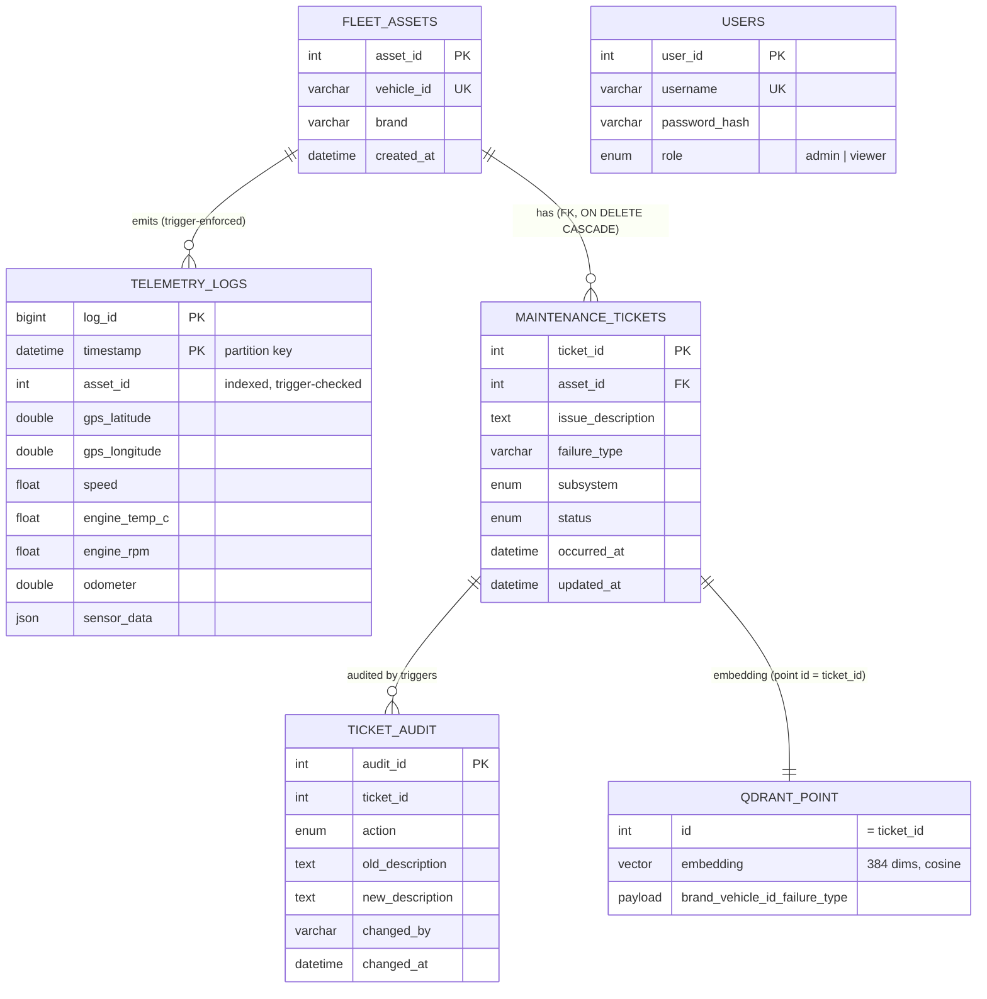

# ER Diagram, Relational Schema and Technology Justification

## ER diagram (MySQL)

## Relational schema, keys and constraints

| Table | Primary key | Other keys / constraints |
|---|---|---|
| `fleet_assets` | `asset_id` | `UNIQUE(vehicle_id)`, `CHECK(vehicle_id not blank)` |
| `telemetry_logs` | `(log_id, timestamp)` (the partition column must be in every unique key) | `CHECK(speed >= 0)`, `CHECK(lat BETWEEN -90 AND 90)`, `CHECK(lon BETWEEN -180 AND 180)`, `CHECK(JSON_VALID(sensor_data))`; `asset_id` validated by trigger `trg_telemetry_check_asset` (MySQL forbids foreign keys on partitioned tables); `RANGE COLUMNS(timestamp)` monthly partitions |
| `maintenance_tickets` | `ticket_id` | `FK asset_id -> fleet_assets ON DELETE CASCADE`, `ENUM` subsystem/status, `CHECK(description not blank)` |
| `ticket_audit` | `audit_id` | filled only by triggers |
| `users` | `user_id` | `UNIQUE(username)`, `ENUM` role, scrypt-hashed password |

Other database objects: view `daily_fleet_stats`; function `fn_failure_count`; procedures `sp_resolve_ticket`,
`sp_fleet_summary`, `ensure_telemetry_partition`; triggers `trg_telemetry_check_asset`,
`trg_asset_delete_telemetry`, `trg_ticket_after_update`, `trg_ticket_after_delete`.

## Role-based access control (in the database)

| MySQL role | Account | Privileges |
|---|---|---|
| `fleet_admin_role` | `fleet_admin` | SELECT/INSERT/UPDATE/DELETE on the three data tables, SELECT on view and `ticket_audit`, EXECUTE on routines |
| `fleet_viewer_role` | `fleet_viewer` | SELECT on the three data tables and the view, EXECUTE on `fn_failure_count` and `sp_fleet_summary` only |
| `fleet_auth_role` | `fleet_auth` | SELECT on `users` only (login lookups) |

The web app logs a user in against `users`, then opens its MySQL connection as the matching account, so the
database itself refuses a viewer's writes (try the "Try a write as viewer" button on the Tickets page).

## Technology justification

- **MySQL 8.4 (relational):** fleet assets, tickets, users and the time-series log are structured and need keys,
  constraints, joins, transactions, triggers and stored routines. MySQL provides RANGE partitioning for the
  high-volume telemetry table, a native `JSON` type for the long tail of minor sensors, CTEs/window functions, and
  roles/GRANTs for access control.
- **Qdrant (vector):** failure descriptions are free text; finding "similar historical failures" is a nearest-neighbour
  problem that SQL `LIKE` cannot do. Qdrant stores the embeddings and supports payload filtering (brand) inside the
  ANN search, plus update/delete by id.
- **Why both:** MySQL is the source of truth; Qdrant holds only a derived index (point id = `ticket_id`), and every
  create/update/delete of a ticket is mirrored to both.
